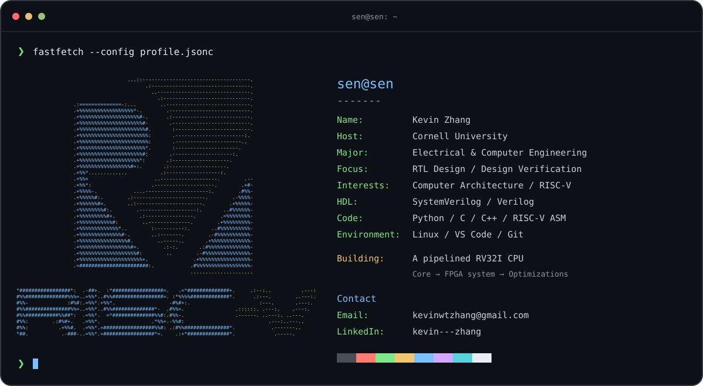

### `~/projects`

- **[Pipelined RISC-V CPU](https://github.com/sen393/riscv-pipelined-cpu)** — A five-stage RV32I core in SystemVerilog, with custom simulation tests and bounded formal verification. Building toward an FPGA system.
- **[Single-Cycle RISC-V CPU](https://github.com/sen393/riscv-single-cycle-cpu)** — A Verilog processor project covering datapath design, self-checking tests, and FPGA synthesis.

### `~/about`

I'm Kevin, an Electrical and Computer Engineering student at Cornell. I enjoy building digital hardware and figuring out how to prove it works. At Cornell Custom Silicon Systems (C2S2), I work on design verification.

### `~/contact`

- **Email:** [kevinwtzhang@gmail.com](mailto:kevinwtzhang@gmail.com)
- **LinkedIn:** [kevin---zhang](https://www.linkedin.com/in/kevin---zhang/)
